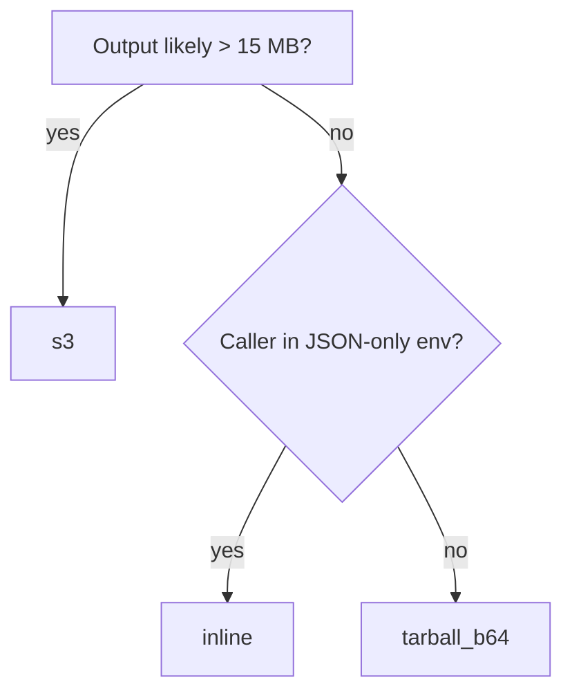

The worker uses one transport choice plus a `formats` list:

- **`transport`** — how the output is shipped (`tarball_b64` / `inline` / `s3`).
- **`formats`** — which artifacts an inline response carries, and which extra renders (HTML, LaTeX, DOCX, EPUB, PDF) any transport adds.

Pick `transport` based on **how big the output is** and **what you want to do with it**. Use `formats` to skip artifacts you don't need, or to ask for a render.

## At a glance

| `transport` | Output shape | Size limit | When to pick it |
|---|---|---|---|
| `"tarball_b64"` *(default)* | entry has `tarball_b64`: base64-encoded `.tar.gz` of the output directory | ~20 MB total response (RunPod gateway cap) | Small to medium docs; you want one blob you can decode and stash anywhere |
| `"inline"` | entry has text/JSON fields plus base64-encoded images, filterable via `formats` | Same ~20 MB cap | You want structured fields back in a JSON-only caller; small docs |
| `"s3"` | entry has `tarball_url`: presigned URL to the same `.tar.gz` on an S3-compatible bucket | No gateway-response cap; worker RAM, disk, timeout, and provider limits still apply | Large docs and image-heavy reports; response stays tiny |

All three modes ship the **same** parse. The archives (`tarball_b64`, `s3`) always carry the six core artifacts below; `inline` carries the subset `formats` names — four of them by default. The choice is about transport, not about what MinerU produces.

Every success response wraps each parsed file in a `results: [...]` entry. For a single-file submission the list has one element; reach into it with `result["results"][0]` (or `MineruClient.first(result)` for the Python client).

## What the worker produces

| `formats` key | File in the archive | Contents |
|---|---|---|
| `markdown` | `{basename}.md` | The document as Markdown. Required: a job that cannot produce readable Markdown fails |
| `content_list` | `{basename}_content_list.json` | MinerU's Content List V1 — a flat list of blocks with the same field names as 1.x (`type`, `text`, `text_level`, `img_path`, `table_body`, `page_idx`, `bbox`, …), plus MinerU 4's `chart` and `index` blocks and `code` blocks with `sub_type: "algorithm"` |
| `middle` | `{basename}_middle.json` | MinerU 4's full document model (`docvortex.middle`, schema 2.0): `metadata`, `pages[].blocks`, and `extensions.mineru` with the tier and parse mode. **Not** the `pdf_info` shape 1.x returned |
| `images` | `images/*` | Extracted images. Inline as `{filename: base64}` |
| `content_list_v2` | `{basename}_content_list_v2.json` | MinerU's Content List V2: the blocks grouped by page |
| `structured_content` | `{basename}_structured_content.json` | MinerU's Structured Content: the document's block tree, page by page, with each block's content as Markdown |
| `html` | `{basename}.html` | Render, on request. Self-contained: images are embedded as `data:` URIs |
| `latex` | `{basename}.tex` | Render, on request. References the files under `images/` |
| `docx` | `{basename}.docx` | Render, on request. Inline as `{filename: base64}` |
| `epub` | `{basename}.epub` | Render, on request. Inline as `{filename: base64}` |
| `pdf` | `{basename}.pdf` | Render, on request. Keeps the source's page layout when the source is a PDF, reflows otherwise. Inline as `{filename: base64}` |

The first four are the inline default, as in 1.x. The archives always carry the first six — the core artifacts — whatever `formats` says, and add each render it lists. Renders are produced only when listed, for every transport; see [Renders](#renders-html-latex-docx-epub-pdf).

Coming from 1.x: `content_list` keeps its field names, but `middle` is a different schema, so code that read its `pdf_info` needs rewriting — see [Upgrading to 2.x](/getting-started/upgrade-to-2/). 1.x archives also carried a `{basename}_layout.pdf`; 2.x archives do not. Field-level reference: [API reference → Success response](/reference/api/#success-response).

## tarball_b64 (default)

```json
{
  "input": {
    "file_url": "https://example.com/report.pdf",
    "transport": "tarball_b64"
  }
}
```

Response (truncated):

```json
{
  "ok": true,
  "results": [
    {
      "basename": "doc",
      "source": "url:https://example.com/report.pdf",
      "pages_requested": -1,
      "tarball_b64": "<base64-encoded .tar.gz, ~1-15 MB typically>"
    }
  ]
}
```

Unpack with `MineruClient.save_tarball(result, "./out")` or any base64 + gzip + tar tooling. **Default** because it round-trips cleanly through any JSON layer and unpacks to a plain directory of files. With the default `basename`, the archive holds:

```text
doc.md
doc_content_list.json
doc_content_list_v2.json
doc_middle.json
doc_structured_content.json
images/
```

plus `doc.html`, `doc.tex`, `doc.docx`, `doc.epub` or `doc.pdf` for each render listed in `formats`. The `s3` transport uploads the same archive.

Hits the 20 MB gateway cap on documents with hundreds of pages of images or layout-dense PDFs. When that happens, switch to `s3`.

## inline

```json
{
  "input": {
    "file_url": "https://example.com/report.pdf",
    "transport": "inline"
  }
}
```

Response (truncated):

```json
{
  "ok": true,
  "results": [
    {
      "basename": "doc",
      "source": "url:https://example.com/report.pdf",
      "pages_requested": -1,
      "markdown": "# Heading\n\nBody text...",
      "content_list": [{"type": "text", "page_idx": 0, "text": "..."}],
      "middle": {"metadata": {"...": "..."}, "pages": [{"page_idx": 0, "blocks": ["..."]}]},
      "images": {"page_0_image_0.png": "<base64>", "page_1_image_0.png": "<base64>"}
    }
  ]
}
```

Same 20 MB cap as `tarball_b64`. Worth it when the caller can't trivially untar — TypeScript / Go services, dashboards, anything that wants to render the markdown directly without an extraction step.

## Filtering with `formats`

For inline transport, `formats` whitelists which artifacts ride back in the entry. Omitted keys are absent from the response — not present-as-empty. Useful when only the markdown matters and the images would otherwise add megabytes of base64 to the payload.

**Just the markdown:**

```json
{
  "input": {
    "file_url": "https://example.com/report.pdf",
    "transport": "inline",
    "formats": ["markdown"]
  }
}
```

Response entry contains only `markdown` (plus the usual `basename` / `source` / `pages_requested`). No other artifact key is present.

**Markdown + content list, skip the images:**

```json
{
  "input": {
    "file_url": "https://example.com/report.pdf",
    "transport": "inline",
    "formats": ["markdown", "content_list"]
  }
}
```

Useful for RAG ingestion where the image blobs aren't needed and removing them speeds up the response.

**Rules**:

- Valid keys are the eleven in [What the worker produces](#what-the-worker-produces). Order doesn't matter. Duplicates collapse silently.
- Empty list is rejected (`formats: []` → validation error). Omit the field to get the default four: `markdown`, `content_list`, `middle`, `images`.
- For `tarball_b64` and `s3`, `formats` can only **add**: those transports always ship the six core artifacts — filtering the contents of an archive would just confuse callers who later download it and find a missing file — plus any render you list. If you want a partial set with those transports, extract the archive and ignore the files you don't need.

## Renders: HTML, LaTeX, DOCX, EPUB, PDF

MinerU 4 can render the parsed document to five more targets. List them in `formats` to get them; they are produced only on request, for every transport.

```json
{
  "input": {
    "file_url": "https://example.com/report.pdf",
    "transport": "inline",
    "formats": ["markdown", "html", "docx"]
  }
}
```

Response entry (truncated):

```json
{
  "basename": "doc",
  "source": "url:https://example.com/report.pdf",
  "pages_requested": -1,
  "markdown": "# Heading\n\nBody text...",
  "html": "<!DOCTYPE html>...",
  "docx": {"doc.docx": "<base64>"}
}
```

- **`html`** is self-contained: its images are embedded as `data:` URIs, so it needs nothing beside it.
- **`latex`** references the files under `images/`. Inline, list `images` too, or take an archive.
- **`docx`, `epub` and `pdf`** are binary, so inline they arrive the way `images` does: a `{filename: base64}` map, here with one entry.
- **`pdf`** keeps the source's page layout when the source is a PDF, and reflows the content otherwise.
- **Renders count toward the ~20 MB inline cap**, and toward the archive's size. HTML embeds its images as base64, so a picture-heavy document makes a large HTML file — and carries those images twice when `images` ships too. For those, prefer `s3`.
- **A render that fails fails the job**, as it does in MinerU's own API, rather than returning without what you asked for.

## s3 (presigned URL)

```json
{
  "input": {
    "file_url": "https://example.com/large-book.pdf",
    "transport": "s3"
  }
}
```

Response is small (~500 bytes):

```json
{
  "ok": true,
  "results": [
    {
      "basename": "doc",
      "source": "url:https://example.com/large-book.pdf",
      "pages_requested": -1,
      "tarball_url": "https://<bucket>.<endpoint>/<key>?<signature>",
      "tarball_url_expires_in": 3600,
      "bucket_key": "doc-<uuid>.tar.gz",
      "bucket_bytes": 87421344
    }
  ]
}
```

The caller downloads the tarball from the bucket and extracts it. `MineruClient.save_s3_tarball(result, "./out")` does the download + extraction in one call.

### If your bucket is on a private network

`save_s3_tarball` refuses a presigned URL that resolves to an address which is not
globally routable, judged on the socket it actually connects to. The URL comes out
of a worker response, so the check is what stops a response from making your
machine open connections inside your own network.

A self-hosted MinIO next to the endpoint is the case where that default is wrong.
Set `MINERU_CLIENT_ALLOW_PRIVATE_FETCH=1` in the environment running the client:

```bash
MINERU_CLIENT_ALLOW_PRIVATE_FETCH=1 python parse.py
```

It is read per call, so a long-running process can set it late. Note it is a
*client* variable: `MINERU_ALLOW_LOCAL_FETCH` governs the worker fetching
`file_url`, runs in a different process, and does not affect this.

### Setup

You need an S3-compatible bucket. Works with **AWS S3, Cloudflare R2, Backblaze B2, Hetzner Object Storage, MinIO**, and anything else that speaks the S3 API with SigV4.

Set four env vars on the RunPod endpoint (the Hub UI surfaces them as a deploy-time form when you deploy the template):

| Env var | Example |
|---|---|
| `BUCKET_ENDPOINT_URL` | `https://<account>.r2.cloudflarestorage.com` (Cloudflare R2) |
| `BUCKET_NAME` | `mineru-outputs` |
| `BUCKET_ACCESS_KEY_ID` | `AKIA...` |
| `BUCKET_SECRET_ACCESS_KEY` | `xxxxxxxx` |

Optional:

| Env var | Default | Notes |
|---|---|---|
| `BUCKET_REGION` | unset | Some providers (AWS) require this; R2 / B2 / MinIO don't |
| `BUCKET_PREFIX` | `""` | Key prefix inside the bucket (e.g. `parses/2026/`); trailing `/` added if missing |
| `BUCKET_PRESIGN_TTL_SECONDS` | `3600` | How long a returned URL stays valid — see [Presigned URL lifetime](#presigned-url-lifetime) |

If a caller requests `transport: "s3"` without those env vars set, the worker raises:

```
ValueError: transport='s3' requires worker env vars: BUCKET_ENDPOINT_URL, BUCKET_NAME, BUCKET_ACCESS_KEY_ID, BUCKET_SECRET_ACCESS_KEY. Set these in the RunPod endpoint env config and redeploy.
```

The job is marked FAILED on the dashboard, so you'll notice immediately.

### Object naming

Each upload uses key `{BUCKET_PREFIX}{basename}-{uuid}.tar.gz` — the UUID prevents collisions when two concurrent jobs share a `basename`. You can set `basename: "my-report"` per job to make the keys human-readable.

### Presigned URL lifetime

Default is **3600 seconds (1 hour)**. Long enough for any human or service to fetch the tarball but short enough that a leaked URL stops working before it's interesting.

`BUCKET_PRESIGN_TTL_SECONDS` changes it per endpoint — shorter when callers fetch immediately, longer when a slow downstream job picks results up later:

```text
BUCKET_PRESIGN_TTL_SECONDS=600
```

Accepted range is 60 to 604800 seconds (SigV4's own seven-day maximum); values outside it clamp, and an unparseable value falls back to the default rather than failing the job. Whatever is used is reported in the response's `tarball_url_expires_in`, so a caller reading that field stays accurate. It is not a per-job setting.

### Costs

You pay S3 egress when the consumer downloads the tarball. On Cloudflare R2, egress is **free**, which is what makes R2 a popular pairing for this pattern. AWS S3 charges per GB.

Storage is the other cost lever — the worker doesn't delete uploaded tarballs. If you don't want long-term storage, set a bucket lifecycle policy (e.g. "delete after 24 h") on the provider side.

### Provider recipes

**Cloudflare R2** (recommended for free egress):

```
BUCKET_ENDPOINT_URL=https://<account-id>.r2.cloudflarestorage.com
BUCKET_NAME=mineru-outputs
BUCKET_ACCESS_KEY_ID=<R2 API token access key>
BUCKET_SECRET_ACCESS_KEY=<R2 API token secret>
```

**AWS S3**:

```
BUCKET_ENDPOINT_URL=https://s3.us-east-1.amazonaws.com
BUCKET_NAME=mineru-outputs
BUCKET_REGION=us-east-1
BUCKET_ACCESS_KEY_ID=AKIA...
BUCKET_SECRET_ACCESS_KEY=...
```

**Backblaze B2** (S3-compatible API):

```
BUCKET_ENDPOINT_URL=https://s3.us-west-002.backblazeb2.com
BUCKET_NAME=mineru-outputs
BUCKET_ACCESS_KEY_ID=<application key ID>
BUCKET_SECRET_ACCESS_KEY=<application key>
```

## Archive format (`tar.gz` or `zip`)

The two archive transports — `tarball_b64` and `s3` — default to a `.tar.gz` container. Set `archive_format: "zip"` for a `.zip` instead:

```json
{
  "input": {
    "file_url": "https://example.com/report.pdf",
    "transport": "s3",
    "archive_format": "zip"
  }
}
```

- Applies only to `tarball_b64` and `s3` — it's a **no-op** for `inline`.
- Default `"tar.gz"` preserves the historical behavior, so existing callers are unaffected.
- The response keys are unchanged (`tarball_b64` / `tarball_url`); only the container differs. For `s3`, the object key extension and Content-Type follow the format (`.tar.gz` + `application/gzip`, or `.zip` + `application/zip`).
- The Python `MineruClient.save_tarball` / `save_s3_tarball` helpers autodetect the container, so they unpack either format.

The main reason to pick `zip` is drop-in compatibility with the official MinerU cloud API's `full_zip_url` — the [`MineruApiClient`](/getting-started/migrate-from-mineru-api/) sets it for you.

## When output comes back short

Whichever mode you pick, a file MinerU wrote can turn out unreadable — bytes
that are not valid UTF-8, JSON cut off by a disk that filled mid-write. One
such file does not fail the job: the affected artifact comes back as its empty
default (or the archive ships without that member), and the entry carries a
`degraded` object naming what was lost and why.

The exception is the Markdown itself. It is the document, so a job that cannot
produce readable Markdown fails with `ok: false` instead of returning an empty
string — you can retry a failed job, but not a successful one that quietly
returned nothing.

`degraded` is absent when nothing was lost, so its presence is the signal to
reprocess that document. Full field reference in
[Incomplete responses](/reference/api/#incomplete-responses).

## Picking the right mode



Rough heuristic in numbers:

- **Under 100 pages, text-heavy** → `tarball_b64` is fine
- **Over 100 pages, image-heavy** → `s3` to avoid the gateway cap
- **Need structured fields back into a non-Python caller** → `inline` (filter with `formats` to skip the parts you don't use)
- **RAG ingestion that only needs the markdown** → `inline` + `formats: ["markdown"]`
- **Production pipeline with bursty 1000+ page docs** → `s3` always; build a janitor that cleans the bucket on a TTL
